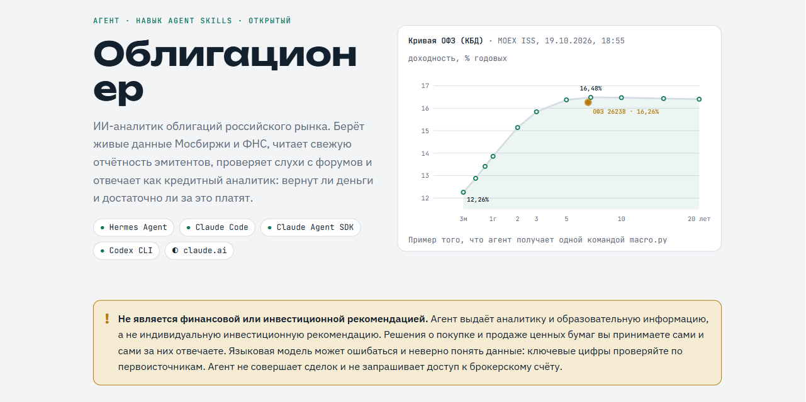
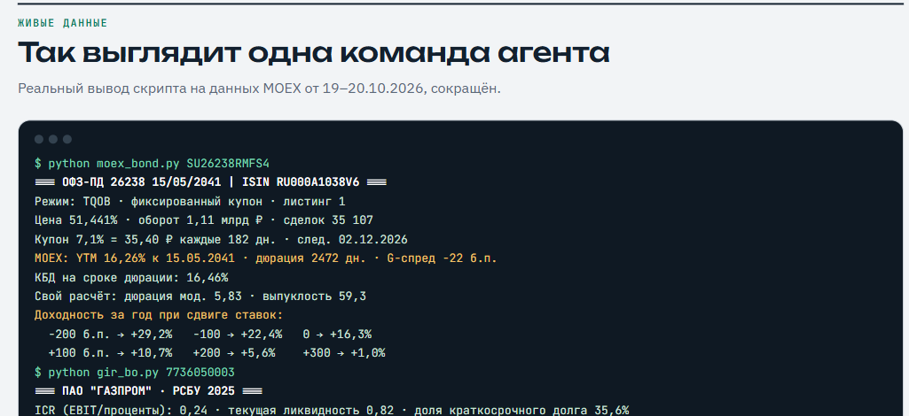

# Облигационер — агент-аналитик облигаций РФ

[Презентация агента](https://ildargiv.github.io/ru-bonds-agent/) · навык по стандарту Agent Skills · Hermes Agent, Claude Code, Codex CLI

Аналитик облигаций российского рынка: живые данные MOEX, РСБУ из ФНС, чтение свежей отчётности, кредитный скоринг, сценарии по ключевой ставке, скрининг, форумы с проверкой фактов.



## Состав
```
SOUL.md                              личность агента (профиль Hermes)
AGENTS.md                            инструкция для Codex, Cursor и др.
agents/claude-code/bonds.md          субагент для Claude Code
install.sh / install.ps1             установка (Hermes, Claude Code, Codex)
skills/finance/ru-bonds/
  SKILL.md                           процедуры: разбор выпуска, подбор, чтение отчёта, макро, мониторинг
  references/
    data-sources.md                  где брать всю информацию (биржа, ЦБ, ФНС, раскрытие, рейтинги, суды)
    analysis-framework.md            методология: рынок, структура, кредит, скоринг 0–100, красные флаги
    reading-reports.md               как читать МСФО/РСБУ/существенные факты
    forums-sentiment.md              форумы: сбор сигналов и обязательная проверка
    report-template.md               шаблон ответа
  scripts/
    moex_bond.py                     карточка облигации + собственные расчёты + сценарии
    screener.py                      скринер всего рынка
    gir_bo.py                        РСБУ эмитента из ГИР БО + коэффициенты
    report_extract.py                чтение PDF-отчётов
    macro.py                         КБД и индексы облигаций
    bond_math.py                     YTM, дюрация, выпуклость, сценарии, НДФЛ
```

## Где работает
Навык сделан по открытому стандарту Agent Skills (SKILL.md), поэтому одна и та же папка подходит для разных сред:

| Среда | Как установить | Что получаете |
|---|---|---|
| Hermes Agent (Linux/macOS/WSL2) | `./install.sh` или `./install.sh hermes-default` | отдельный профиль `bonds` с характером из SOUL.md, либо навык в основном профиле |
| Claude Code (CLI, десктоп, IDE) | `./install.sh claude`; в Windows `powershell -ExecutionPolicy Bypass -File install.ps1 claude` | навык `ru-bonds` + субагент `bonds` |
| Claude Agent SDK | папку `skills/finance/ru-bonds` в `.claude/skills/` проекта | тот же навык в вашем приложении |
| Codex CLI | `./install.sh codex` (или `install.ps1 codex`) | навык `ru-bonds`; также читает `AGENTS.md` |
| claude.ai (сайт, приложение) | заархивировать папку `ru-bonds` в zip и загрузить в настройках, раздел Skills | методология и источники; скрипты могут не достучаться до MOEX и ФНС из песочницы, тогда агент использует веб-поиск |
| Другие среды | скопировать папку навыка в их каталог навыков или открыть папку с `AGENTS.md` | зависит от среды |

Скачать:
```bash
git clone https://github.com/ildargiv/ru-bonds-agent.git && cd ru-bonds-agent && chmod +x install.sh
```
Затем запустите установку для своей среды (см. таблицу выше). В Windows Hermes работает через WSL: клонируйте репозиторий внутри WSL.

## Примеры запросов
- «Разбери RU000A10DK98: стоит ли держать до оферты?»
- «Подбери 10 облигаций с ежемесячным купоном, доходность от 18%, до 2 лет, без ВДО»
- «Прочитай свежую МСФО Сегежи и скажи, что изменилось для облигационеров»
- «Что сейчас выгоднее при текущей ключевой ставке: длинные ОФЗ или флоатеры?»
- «Что пишут на форумах про <эмитент>? Проверь, что из этого правда»
- «Каждый будний день в 10:00 проверяй мой портфель [ISIN…] и присылай сводку» (cron Hermes)



## Проверка скриптов вручную
```bash
python3 skills/finance/ru-bonds/scripts/moex_bond.py SU26238RMFS4
python3 skills/finance/ru-bonds/scripts/screener.py --boards TQCB --min-yield 18 --max-dur-days 730 --min-volume 5000000
python3 skills/finance/ru-bonds/scripts/gir_bo.py 7736050003
```
## Лицензия
MIT, см. [LICENSE](LICENSE).

**Важно.** Агент даёт аналитику и образовательную информацию. Это не индивидуальная инвестиционная рекомендация и не финансовый совет. Решения об инвестициях и ответственность за них — на пользователе. Агент может ошибаться: проверяйте ключевые цифры по первоисточникам.
