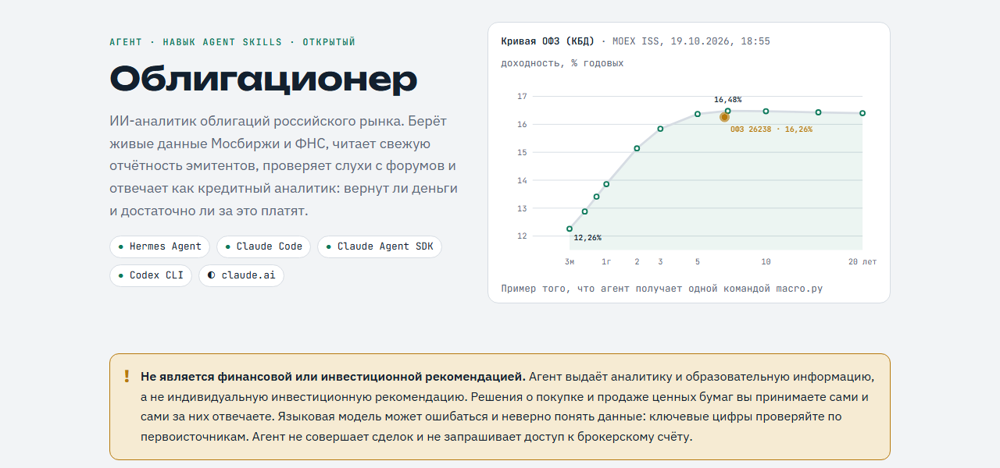
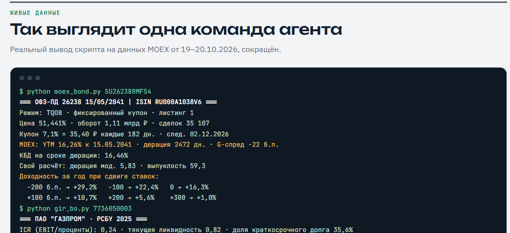

# Облигационер — ИИ-агент для анализа облигаций РФ (MOEX, ОФЗ)

[](LICENSE)      [](https://github.com/ildargiv/ru-bonds-agent/actions/workflows/ci.yml) [](https://github.com/ildargiv/ru-bonds-agent/releases)

**Открытый ИИ-агент-аналитик облигаций** для Hermes Agent, Claude Code и Codex CLI: ОФЗ и корпоративные выпуски, живые данные Мосбиржи, YTM, дюрация и сценарии по ключевой ставке, РСБУ из ФНС, кредитный скоринг, скринер, форумы с проверкой, список наблюдения и база знаний в Obsidian.

[Презентация агента](https://ildargiv.github.io/ru-bonds-agent/?utm_source=github&utm_medium=readme&utm_campaign=ru-bonds-agent) · [English](#english) · [База знаний в Obsidian](#база-знаний-в-obsidian) · [Семейство агентов](#семейство-агентов) · [Где работает](#где-работает)

Аналитик облигаций российского рынка: живые данные MOEX, РСБУ из ФНС, чтение свежей отчётности, кредитный скоринг, сценарии по ключевой ставке, скрининг, форумы с проверкой фактов.



## Состав
```
SOUL.md                              личность агента (профиль Hermes)
AGENTS.md                            инструкция для Codex, Cursor и др.
agents/claude-code/bonds.md          субагент для Claude Code
install.sh / install.ps1             установка (Hermes, Claude Code, Codex)
skills/finance/ru-bonds/
  SKILL.md                           процедуры: разбор выпуска, подбор, чтение отчёта, макро, мониторинг
  references/
    data-sources.md                  где брать всю информацию (биржа, ЦБ, ФНС, раскрытие, рейтинги, суды)
    analysis-framework.md            методология: рынок, структура, кредит, скоринг 0–100, красные флаги
    reading-reports.md               как читать МСФО/РСБУ/существенные факты
    forums-sentiment.md              форумы: сбор сигналов и обязательная проверка
    report-template.md               шаблон ответа
    desk-structure.md                хранилище: папка выпуска, эмитенты, правила ведения
    wiki.md                          база знаний: формат Obsidian-вики, общий для всех агентов семейства
  scripts/
    desk.py                          список наблюдения, папки выпусков, что изменилось, итоги разборов
    wiki.py                          база знаний Obsidian: хабы, эмитенты, index, log, поиск, проверка, дайджест
    moex_bond.py                     карточка облигации + собственные расчёты + сценарии
    screener.py                      скринер всего рынка
    gir_bo.py                        РСБУ эмитента из ГИР БО + коэффициенты
    report_extract.py                чтение PDF-отчётов
    macro.py                         КБД и индексы облигаций
    bond_math.py                     YTM, дюрация, выпуклость, сценарии, НДФЛ
```

## Хранилище выпусков
```
~/bonds-desk/                        открывается в Obsidian как хранилище
  index.md  log.md  topics/  digests/  _templates/
  watchlist.json                     выпуски под наблюдением
  issuers/ПАО ГК Самолет.md          эмитент: кредитный профиль и выпуски
  RU000A10DK98/
    RU000A10DK98.md  хаб выпуска      README.md  карточка      thesis.md  кредитный тезис
    journal.md       хронология       market/    снимки цены и YTM
    reports/         отчёты + конспекты   analyses/  разборы     news/ forums/
```
Корень меняется переменной `BONDS_DESK` (или `INVEST_VAULT` — общее хранилище всех агентов, папка `bonds/`).

## База знаний в Obsidian
Хранилище агента — это готовая **LLM-вики в формате Obsidian**: markdown-заметки со ссылками `[[...]]` и свойствами (YAML-frontmatter), которые агент пишет и читает сам. Откройте папку `~/bonds-desk` в Obsidian («Открыть папку как хранилище») и увидите граф связей, обратные ссылки и свойства.

- **Список наблюдения и папка на каждый выпуск.** «Следи за RU000A10DK98» — агент заводит папку: хаб `RU000A10DK98/RU000A10DK98.md` (вердикт, кредитный скоринг, справедливая доходность, дата разбора), карточку, кредитный тезис, хронологию, снимки цены и YTM. `desk.py status` покажет оферты и погашения в ближайшие 60 дней, движение цены и доходности, дефолт.
- **Заметка на эмитента** (`issuers/`): кредитный профиль и все его выпуски под наблюдением.
- **Сырые документы — вложения**, рядом заметка-конспект с цифрами и номерами страниц.
- **`log.md` — журнал знаний**: что агент узнал, вывел или исправил, с источником. **`index.md`** собирается автоматически.
- **Проверка вики** (`wiki.py lint`): битые ссылки, цифры без источника, устаревшие тезисы, незаконспектированные отчёты, противоречия между заметками.
- **Недельный дайджест** (`wiki.py digest`), **шаблоны** заметок, **сквозные темы** (`topics/`: ставка ЦБ, отрасли).
- **Все агенты в одном Obsidian:** задайте всем `INVEST_VAULT=~/invest-vault` — у каждого будет своя подпапка, а темы, шаблоны и стартовая страница станут общими. Формат одинаковый во всех агентах семейства: [`references/wiki.md`](skills/finance/ru-bonds/references/wiki.md).
- Личные данные (ваши позиции и цены покупки) в вики не попадают и лежат в файлах из `.gitignore` хранилища.

## Где работает
Навык сделан по открытому стандарту Agent Skills (SKILL.md), поэтому одна и та же папка подходит для разных сред:

| Среда | Как установить | Что получаете |
|---|---|---|
| Hermes Agent (Linux/macOS/WSL2) | `./install.sh` или `./install.sh hermes-default` | отдельный профиль `bonds` с характером из SOUL.md, либо навык в основном профиле |
| Claude Code (CLI, десктоп, IDE) | `./install.sh claude`; в Windows `powershell -ExecutionPolicy Bypass -File install.ps1 claude` | навык `ru-bonds` + субагент `bonds` |
| Claude Agent SDK | папку `skills/finance/ru-bonds` в `.claude/skills/` проекта | тот же навык в вашем приложении |
| Codex CLI | `./install.sh codex` (или `install.ps1 codex`) | навык `ru-bonds`; также читает `AGENTS.md` |
| claude.ai (сайт, приложение) | заархивировать папку `ru-bonds` в zip и загрузить в настройках, раздел Skills | методология и источники; скрипты могут не достучаться до MOEX и ФНС из песочницы, тогда агент использует веб-поиск |
| Другие среды | скопировать папку навыка в их каталог навыков или открыть папку с `AGENTS.md` | зависит от среды |

Скачать:
```bash
git clone https://github.com/ildargiv/ru-bonds-agent.git && cd ru-bonds-agent && chmod +x install.sh
```
Затем запустите установку для своей среды (см. таблицу выше). В Windows Hermes работает через WSL: клонируйте репозиторий внутри WSL.

## Примеры запросов
- «Разбери RU000A10DK98: стоит ли держать до оферты?»
- «Подбери 10 облигаций с ежемесячным купоном, доходность от 18%, до 2 лет, без ВДО»
- «Прочитай свежую МСФО Сегежи и скажи, что изменилось для облигационеров»
- «Что сейчас выгоднее при текущей ключевой ставке: длинные ОФЗ или флоатеры?»
- «Что пишут на форумах про <эмитент>? Проверь, что из этого правда»
- «Следи за RU000A10DK98 и Самолётом в целом» · «Что изменилось по моему списку облигаций?»
- «Что мы уже знаем про долг Самолёта? Посмотри в базе знаний»
- «Каждый будний день в 10:00 проверяй мой портфель [ISIN…] и присылай сводку» (cron Hermes)



## Проверка скриптов вручную
```bash
python3 skills/finance/ru-bonds/scripts/moex_bond.py SU26238RMFS4
python3 skills/finance/ru-bonds/scripts/screener.py --boards TQCB --min-yield 18 --max-dur-days 730 --min-volume 5000000
python3 skills/finance/ru-bonds/scripts/gir_bo.py 7736050003
python3 skills/finance/ru-bonds/scripts/desk.py add RU000A10DK98 --note "девелопер"
python3 skills/finance/ru-bonds/scripts/desk.py status
python3 skills/finance/ru-bonds/scripts/wiki.py lint
```
## Семейство агентов
Каждый агент живёт в своём репозитории и ставится отдельно. Если нужен ещё один, установите его рядом, одной командой (для Claude Code: `./install.sh claude`, для Hermes: `./install.sh`):

| Агент | Для чего | Установка |
|---|---|---|
| [Инвесткомитет · ru-stocks-agent](https://github.com/ildargiv/ru-stocks-agent) | анализ акций Мосбиржи: список наблюдения, папка на акцию, инвесткомитет с адвокатом дьявола | `git clone https://github.com/ildargiv/ru-stocks-agent.git && cd ru-stocks-agent && ./install.sh claude` |
| [Облигационер · ru-bonds-agent](https://github.com/ildargiv/ru-bonds-agent) | облигации РФ: ОФЗ и корпоративные выпуски, YTM, дюрация, кредитный скоринг, скринер | `git clone https://github.com/ildargiv/ru-bonds-agent.git && cd ru-bonds-agent && ./install.sh claude` |
| [Семейный офис · ru-portfolio-agent](https://github.com/ildargiv/ru-portfolio-agent) | портфель акций: ежедневный брифинг после закрытия биржи, недельный обзор против IMOEX | `git clone https://github.com/ildargiv/ru-portfolio-agent.git && cd ru-portfolio-agent && ./install.sh claude` |
| [FinEx · finex-agent](https://github.com/ildargiv/finex-agent) | пайщикам фондов FinEx в ликвидации: документы, новости, модель выплаты на пай | `git clone https://github.com/ildargiv/finex-agent.git && cd finex-agent && ./install.sh claude` |

Все агенты пишут базу знаний в одном формате Obsidian-вики: задайте им общую папку `INVEST_VAULT=~/invest-vault`, и акции, портфель, облигации и FinEx окажутся в одном хранилище Obsidian со связями между заметками.

## English
**Bond Analyst (ru-bonds-agent)** is an open-source AI agent skill for analysing Russian bonds (OFZ government bonds and corporate issues) on the Moscow Exchange (MOEX). It pulls live market data from MOEX ISS, issuer RAS financials from the Federal Tax Service (GIR BO), reads fresh IFRS reports and disclosures, computes YTM, duration, convexity and key-rate scenarios, scores credit quality 0–100 with red flags, screens the whole market, and checks forum rumours against primary sources. It keeps a bond watchlist with a folder per issue and a note per issuer. Its storage is an **Obsidian-compatible LLM wiki**: markdown notes with [[wikilinks]] and YAML frontmatter that the agent reads and writes itself (hub note per bond issue, source notes for raw documents, a knowledge log, generated index, wiki lint for broken links, uncited numbers, stale notes and contradictions, weekly digest). All agents of the family share one format and can live in one Obsidian vault (`INVEST_VAULT`). Built on the open Agent Skills standard (SKILL.md); works in Hermes Agent, Claude Code, Codex CLI, the Claude Agent SDK and claude.ai. Python 3.9+, standard library only. The agent answers in Russian. Analytics only, not investment advice.

## Лицензия
MIT, см. [LICENSE](LICENSE).

**Важно.** Агент даёт аналитику и образовательную информацию. Это не индивидуальная инвестиционная рекомендация и не финансовый совет. Решения об инвестициях и ответственность за них — на пользователе. Агент может ошибаться: проверяйте ключевые цифры по первоисточникам.
